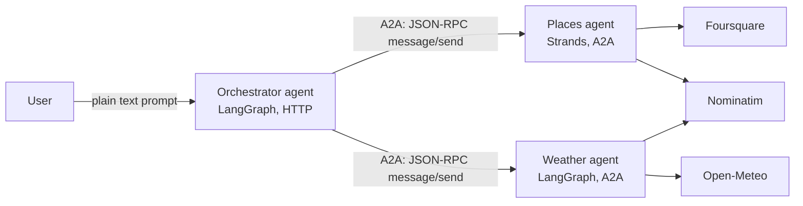

# City Explorer: a multi-agent system with A2A on AWS AgentCore

A user asks about a place in Bengaluru, for example:

> "I want to go to Indiranagar in Bengaluru. What can I do there and how is the air quality?"

Three agents answer it together. Each one is built with a different setup and deployed as its own runtime on Amazon Bedrock AgentCore. They talk to each other over the **A2A (Agent2Agent) protocol**.

I built this to learn A2A properly. This README covers what the project does, how the folders were created, what goes into each `main.py`, and the exact steps I used to deploy it.


## The three agents

| Agent | Folder | Framework | Protocol | What it does |
|---|---|---|---|---|
| Places agent | `Cityplacesagent/` | Strands | A2A | Finds real places, plans a walking route, finds a meeting spot for two people, compares areas. Uses Foursquare and Nominatim. |
| Weather agent | `Weatheragent/` | LangGraph | A2A | Air quality (US AQI, PM2.5, PM10, UV), temperature, rain chance, sunrise and sunset. Uses Open-Meteo and Nominatim. |
| Orchestrator agent | `OrchestratorAgent/` | LangGraph (with LangChain) | HTTP | Takes a plain text question, decides which agent to ask, calls them over A2A, and merges the answers. |

All three use Claude Haiku 4.5 on Amazon Bedrock.

## How a request flows



1. The user sends a plain text prompt to the orchestrator (a normal HTTP agent, no JSON-RPC).
2. The orchestrator's model reads the question and calls one or both tools: `ask_places_agent`, `ask_conditions_agent`.
3. Each tool sends a JSON-RPC `message/send` request to the other agent's runtime. The request is signed with AWS credentials.
4. Each specialist agent runs its own tools (Foursquare, Open-Meteo) and replies with text.
5. The orchestrator merges the replies into one answer.

Both specialist agents geocode the place name with Nominatim, so a string like `Indiranagar, Bengaluru` resolves to the same coordinates in both.

### Where A2A, JSON-RPC and the agent card fit

- **A2A** is the agreement between the orchestrator and each specialist agent.
- **JSON-RPC** is the format of the request the orchestrator sends and of the reply that comes back.
- **Agent card** is a JSON file each A2A agent serves at `/.well-known/agent-card.json`. It lists the agent's name, URL and skills.

A request from the orchestrator to the Weather agent looks like this:

```json
{
  "jsonrpc": "2.0",
  "id": "a1b2c3",
  "method": "message/send",
  "params": {
    "message": {
      "role": "user",
      "messageId": "d4e5f6",
      "parts": [{"kind": "text", "text": "Air quality in Indiranagar, Bengaluru?"}]
    }
  }
}
```

## Repository layout

```
city-explorer-agent/
├── Cityplacesagent/            # Places agent (Strands, A2A)
│   ├── agentcore/              # agentcore.json, aws-targets.json, cdk/
│   └── app/Myagent/
│       ├── main.py
│       ├── pyproject.toml
│       └── uv.lock
├── Weatheragent/               # Weather agent (LangGraph, A2A)
│   ├── agentcore/
│   └── app/Weather/
│       ├── main.py
│       ├── tools.py
│       ├── test.py
│       ├── pyproject.toml
│       └── uv.lock
├── OrchestratorAgent/          # Orchestrator (LangGraph, HTTP)
│   ├── agentcore/
│   └── app/orchestrator/
│       ├── main.py
│       ├── city_tools.py
│       ├── test_local.py
│       ├── .python-version
│       ├── pyproject.toml
│       └── uv.lock
└── docs/
    └── architecture.png
```

All three projects have the same structure, because they were all created with the same command.

## How the project structure was created

The folders come from the **AgentCore CLI**, which is installed with npm. I ran `agentcore create` once for each agent. It generates the project folder with an `agentcore/` configuration folder, an `app/<AgentName>/` code folder with a starter `main.py` and `pyproject.toml`, and a CDK folder for deployment.

```
MyAgent/
├── agentcore/
│   ├── agentcore.json      # project and agent configuration
│   ├── aws-targets.json    # AWS account and region to deploy to
│   ├── .env.local          # local environment variables (gitignored)
│   └── cdk/                # deployment infrastructure (auto-managed)
└── app/
    └── MyAgent/
        ├── main.py         # agent entrypoint (starter code)
        └── pyproject.toml  # Python dependencies
```

### Install the CLI

You need Node.js 20 or newer and AWS credentials configured on your machine.

```bash
npm install -g @aws/agentcore
agentcore --help
```

I built this with CLI version 0.27.1.

### Create the three projects

Run `agentcore create` in an empty folder for each agent. The wizard asks for a name, then a framework, protocol, model provider and memory option. These are the answers I used:

| Project | Framework | Protocol | Model provider | Memory | Build |
|---|---|---|---|---|---|
| Cityplacesagent | Strands | A2A | Bedrock | none | CodeZip |
| Weatheragent | LangChain_LangGraph | A2A | Bedrock | none | CodeZip |
| OrchestratorAgent | LangChain_LangGraph | HTTP | Bedrock | none | CodeZip |

You can also pass flags to skip the wizard. The flag names differ a little between CLI versions, so check `agentcore create --help` first. The AWS docs show this form:

```bash
agentcore create --name MyAgent --framework LangChain_LangGraph --protocol A2A --model-provider Bedrock --memory none
```

The protocol matters. An A2A agent serves an agent card and listens on port 9000. An HTTP agent exposes an `/invocations` endpoint. The orchestrator is HTTP because users send it a plain prompt, and only its calls to the other two agents use JSON-RPC.

## What goes inside each `main.py`

The generated `main.py` is only starter code. I replaced it in each project.

### Places agent (`Cityplacesagent/app/Myagent/main.py`)

- Four tools written as plain Python functions: `find_places`, `plan_walking_route`, `meet_in_the_middle`, `compare_areas`.
- Foursquare for live places and Nominatim for geocoding (cached and limited to 1 request per second).
- A Strands `Agent` with a Bedrock model and a system prompt that says to use only tool output.
- An agent card with one skill per tool.
- The A2A server started with:

```python
serve_a2a(StrandsA2AExecutor(agent), build_card(), host=os.getenv("A2A_HOST"))
```

### Weather agent (`Weatheragent/app/Weather/main.py` and `tools.py`)

- Two tools in `tools.py`: `get_air_quality` and `get_weather`. They geocode the area with Nominatim, call Open-Meteo, and return text. The AQI rating (Good, Moderate, and so on) is calculated in plain code.
- A LangGraph agent created with `create_react_agent` and a Bedrock model.
- A small `ConditionsExecutor` class that passes the incoming A2A message to the graph and returns the answer as an A2A message.
- An agent card with two skills: air quality, and weather and sunset.
- The A2A server started with `serve_a2a(ConditionsExecutor(), build_card(), ...)`.

### Orchestrator agent (`OrchestratorAgent/app/orchestrator/main.py` and `city_tools.py`)

- `city_tools.py` has `call_a2a()`, which sends the JSON-RPC `message/send` request to a deployed runtime with boto3 (`invoke_agent_runtime`). It also has two functions, `places()` and `conditions()`, which call the right runtime and return errors as text.
- `main.py` builds a LangGraph agent with two tools, `ask_places_agent` and `ask_conditions_agent`, that wrap those functions. The system prompt tells the model to call both agents for combined questions and to keep the map links and the Open-Meteo credit.
- The graph is built on the first request, not when the module loads, so the runtime starts quickly.
- It is a normal HTTP agent:

```python
app = BedrockAgentCoreApp()

@app.entrypoint
async def invoke(payload, context=None):
    prompt = payload.get("prompt")
    result = await get_graph().ainvoke({"messages": [("user", prompt)]})
    return {"result": ...}
```

## Dependencies

Each agent has its own `pyproject.toml`, managed with [uv](https://docs.astral.sh/uv/).

**Places agent**

```toml
dependencies = [
    "bedrock-agentcore[a2a]",
    "strands-agents[a2a]",
    "requests",
]
```

**Weather agent**

```toml
dependencies = [
    "bedrock-agentcore[a2a]",
    "a2a-sdk[http-server]>=0.3.26,<1.0",
    "langchain-aws",
    "langgraph",
    "requests",
    "aws-opentelemetry-distro",
]
```

**Orchestrator agent**

```toml
dependencies = [
    "bedrock-agentcore",
    "langchain-aws",
    "langgraph",
    "boto3",
    "aws-opentelemetry-distro",
]
```

Two of these lines are there because of errors I hit, and both are explained in the troubleshooting section: the `a2a-sdk` version limit and `aws-opentelemetry-distro`.

## Environment variables

| Variable | Used by | Purpose |
|---|---|---|
| `FSQ_API_KEY` | Places agent | Foursquare Places API key (required) |
| `NOMINATIM_USER_AGENT` | Places and Weather agents | Identifies your app to Nominatim, for example `city-explorer-agent/1.0 (your-repo-url)` |
| `BEDROCK_MODEL_ID` | All | Defaults to `us.anthropic.claude-haiku-4-5-20251001-v1:0` |
| `AWS_REGION` | All | Region for the Bedrock model |
| `PLACES_AGENT_ARN` | Orchestrator | Runtime ARN of the deployed Places agent |
| `CONDITIONS_AGENT_ARN` | Orchestrator | Runtime ARN of the deployed Weather agent |
| `AGENTS_REGION` | Orchestrator | Region of the two specialist runtimes (defaults to `us-east-1`) |

For local runs, put them in `agentcore/.env.local` (gitignored). For deployed runs, put them in the `envVars` section of that agent's `agentcore/agentcore.json`. The `.env.local` file is not used in the cloud.

## Prerequisites

- An AWS account with credentials configured, in a region where AgentCore is available
- Access to Claude Haiku 4.5 enabled in Amazon Bedrock
- Node.js 20 or newer, for the AgentCore CLI
- [uv](https://docs.astral.sh/uv/) and Python 3.10 or newer (I used 3.13)
- A free Foursquare Places API key, for the Places agent

## Deployment steps

Deploy the two specialist agents first, because the orchestrator needs their ARNs. All commands below work in PowerShell. I used Windows.

### 1. Test the Places agent locally

```bash
cd Cityplacesagent
# add FSQ_API_KEY to agentcore/.env.local
agentcore dev
```

A2A agents run on port 9000 locally, so only one A2A agent can run at a time. Stop the dev server before starting the next one.

### 2. Deploy the Places agent

```bash
agentcore deploy
agentcore status
```

`agentcore deploy` packages the code as a ZIP and creates the runtime through CDK. Add `FSQ_API_KEY` to `envVars` in `agentcore/agentcore.json` first. `agentcore status` shows the runtime state (it should be READY) and the runtime ARN. Copy the ARN.

### 3. Test and deploy the Weather agent

```bash
cd ../Weatheragent
agentcore dev
```

In a second terminal, run the test client:

```bash
cd app/Weather
uv run test.py
```

The client reads the agent card and sends a `message/send` request. A working agent returns an AQI with a rating, PM2.5 and PM10, and the Open-Meteo credit. Then stop the dev server and deploy:

```bash
agentcore deploy
agentcore status
```

Copy this runtime ARN as well.

### 4. Set up the orchestrator

Put the two ARNs in `OrchestratorAgent/agentcore/agentcore.json`, in the `envVars` of the orchestrator runtime:

```
PLACES_AGENT_ARN=arn:aws:bedrock-agentcore:<region>:<account-id>:runtime/<places-runtime-id>
CONDITIONS_AGENT_ARN=arn:aws:bedrock-agentcore:<region>:<account-id>:runtime/<weather-runtime-id>
AGENTS_REGION=<region>
```

Use the runtime ARN, without the `/runtime-endpoint/DEFAULT` part.

### 5. Test the orchestrator locally

This runs the LangGraph agent directly and calls the two deployed agents with your own AWS credentials:

```bash
cd OrchestratorAgent/app/orchestrator
uv run python test_local.py
```

The output prints the tool calls the model made and the final answer. For the combined question, both tools should appear in the tool calls. You can also run `agentcore dev` and use the chat UI it opens.

### 6. Give the orchestrator permission to call the other agents

When deployed, the orchestrator calls the other runtimes with its own execution role, not your credentials. That role needs permission to invoke them. Add this inline policy to the orchestrator's role (replace the placeholders):

```json
{
  "Version": "2012-10-17",
  "Statement": [
    {
      "Sid": "InvokeAgentRuntimes",
      "Effect": "Allow",
      "Action": "bedrock-agentcore:InvokeAgentRuntime",
      "Resource": [
        "arn:aws:bedrock-agentcore:<region>:<account-id>:runtime/*",
        "arn:aws:bedrock-agentcore:<region>:<account-id>:runtime/*/runtime-endpoint/*"
      ]
    }
  ]
}
```

Find the role name from the deployed runtime, then attach the policy:

```bash
aws bedrock-agentcore-control get-agent-runtime --agent-runtime-id <orchestrator-runtime-id> --region <region> --query roleArn
aws iam put-role-policy --role-name <role-name> --policy-name InvokeAgentRuntimes --policy-document file://invoke-agents-policy.json
```

This policy covers every runtime in the account. For anything beyond a learning project, list only the two ARNs instead.

### 7. Deploy the orchestrator

```bash
cd OrchestratorAgent
agentcore deploy
agentcore status
```

### 8. Invoke it

```bash
agentcore invoke "I want to go to Indiranagar in Bengaluru. What can I do there and how is the air quality?"
```

The first call after a deploy is slow because of the cold start and two remote agent calls. Run it a second time to see the normal speed.

## Example questions

| Question | What should happen |
|---|---|
| I want to go to Indiranagar in Bengaluru. What can I do there and how is the air quality? | Both agents are called and the answers are merged |
| Plan an evening in Indiranagar with a cafe, then a temple, then dinner. Will it rain, and when is sunset? | Places agent builds the route, Weather agent adds rain and sunset |
| How is the air quality in Jayanagar right now? | Only the Weather agent is called |
| Two friends live in Whitefield and Jayanagar. Where can they meet for coffee this evening, and what is the weather like? | Places agent uses meet in the middle, Weather agent checks conditions |

## Troubleshooting

These are the errors I hit while building this, and what fixed them.

| Problem | Cause | Fix |
|---|---|---|
| `ImportError: cannot import name 'new_agent_text_message' from 'a2a.utils'` | uv installed `a2a-sdk` 1.x, which changed the SDK. The AgentCore library expects the 0.3 line. | Pin `a2a-sdk[http-server]>=0.3.26,<1.0` in `pyproject.toml` |
| `Port 9000 is in use` | Another A2A dev server, or a leftover Python process, holds the port | `netstat -ano \| findstr :9000`, then `Stop-Process -Id <PID> -Force` |
| `Error loading ASGI app. Attribute "app" not found in module "main"` | The runtime protocol is HTTP, but `main.py` starts an A2A server with `serve_a2a` | Set `"protocol": "A2A"` in `agentcore.json` for the A2A agents. The orchestrator is the HTTP agent and defines `app = BedrockAgentCoreApp()` |
| `CREATE_FAILED: OpenTelemetry instrumentation executable not found` | The runtime starts agents through OpenTelemetry, and the ZIP did not include it | Add `aws-opentelemetry-distro` to `pyproject.toml` |
| `Runtime initialization time exceeded` | The runtime has 30 seconds to start. In my case the runtime logs also showed that pyenv could not find the Python version the runtime asked for. | Check the runtime logs. Make sure the Python version in `agentcore.json` matches your local Python (`.python-version`), and keep heavy imports out of module load, as the orchestrator does |
| Orchestrator tool returns `AccessDeniedException` | The orchestrator's role cannot invoke the other runtimes | Attach the policy from step 6 |
| Code changes do not show up after a redeploy | Existing sessions keep the code they started with | Use a new session ID when you test |

## Tear down

```bash
agentcore remove all
agentcore deploy
```

`remove all` clears the configuration, and the deploy that follows deletes the AWS resources. Run it inside each of the three project folders. Copy `agentcore/agentcore.json` first if you want to deploy again later.


## Data sources

- Weather and air quality data by [Open-Meteo.com](https://open-meteo.com/)
- Places data from [Foursquare](https://foursquare.com/developers/)
- Geocoding by [OpenStreetMap Nominatim](https://nominatim.org/). Its usage policy limits requests to one per second, and the code follows that.

## Built with

[Amazon Bedrock AgentCore](https://docs.aws.amazon.com/bedrock-agentcore/), [Strands Agents](https://strandsagents.com/), [LangGraph](https://langchain-ai.github.io/langgraph/), [A2A protocol](https://a2a-protocol.org/), [uv](https://docs.astral.sh/uv/)
